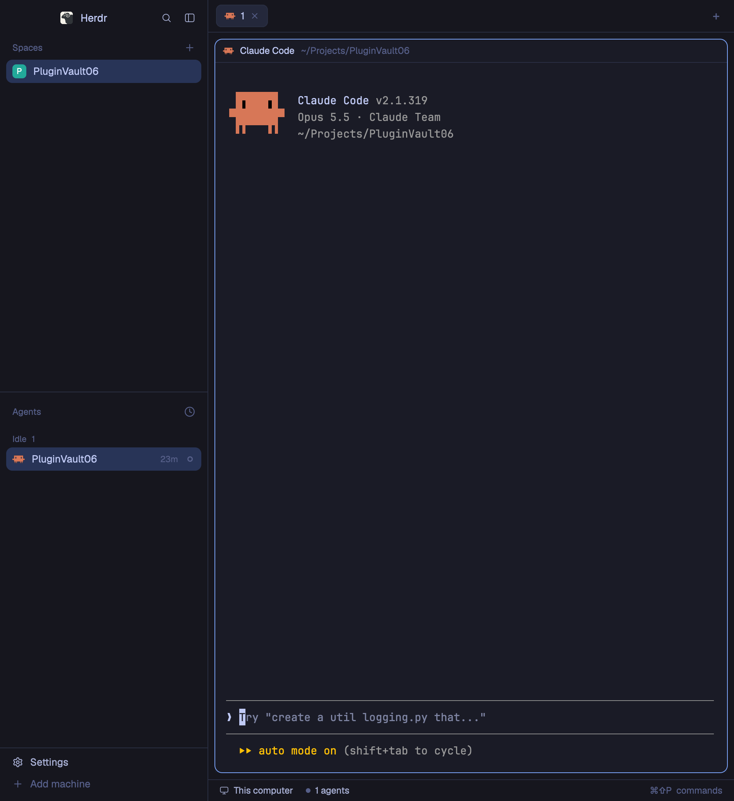

# Tokyo Night for Herdr

A [Herdr](https://herdr.dev) desktop app layout: the default window in the night-blue Tokyo Night palette.



## Install

Ask your agent:

> Add the Herdr layout from https://github.com/mustafaergul/herdr-tokyo-night

Or by hand:

```sh
git clone https://github.com/mustafaergul/herdr-tokyo-night
cp herdr-tokyo-night/layouts/tokyo-night.* ~/.config/herdr-app/layouts/
herdr-app do layout.switch --name tokyo-night
```

Switch back any time with `herdr-app do layout.switch --name main`, or from Settings → Layouts.

### Just the colors

`themes/tokyo-night.json` is the same palette as a theme file. To use it on any layout:

```sh
cp herdr-tokyo-night/themes/tokyo-night.json ~/.config/herdr-app/themes/
herdr-app do app.theme --name tokyo-night
```

## Files

- `layouts/tokyo-night.json`: the layout (Herdr's default structure, Tokyo Night colors built in)
- `layouts/tokyo-night.svg`: its picture in Settings
- `themes/tokyo-night.json`: the palette on its own
- `RECIPE.md`: how to rebuild it from scratch

Palette: [Tokyo Night](https://github.com/folke/tokyonight.nvim). MIT licensed.
