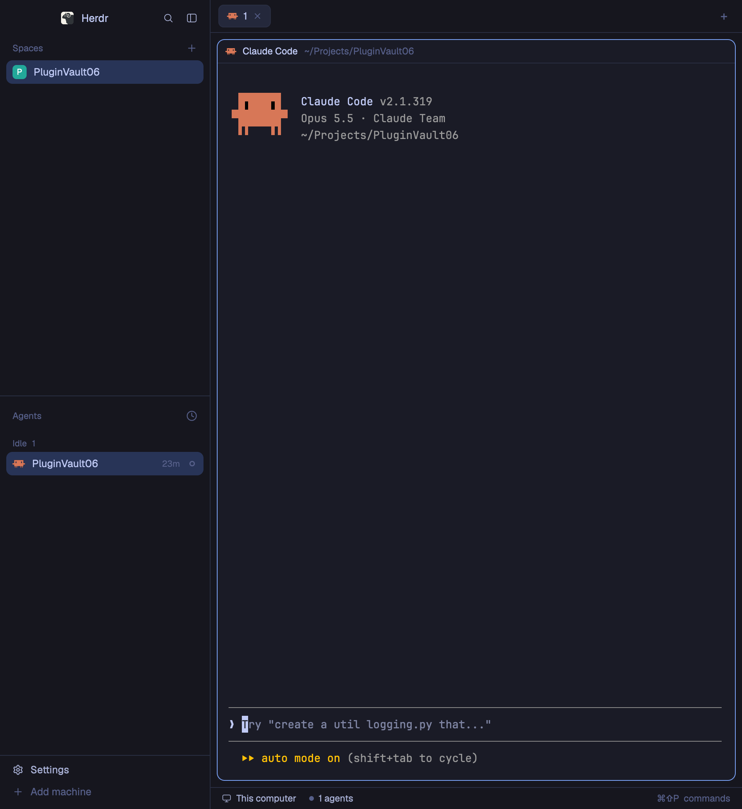

# Tokyo Night

Herdr's default window (spaces and agents sidebar, tab bar, bordered terminal panes, status bar) painted in the night-blue Tokyo Night palette. Nothing moves or changes shape compared with the shipped `main` layout; every panel, terminal and agent dot takes its color from Tokyo Night.

## What you see

Left to right, with the window's own title bar hidden (`"titlebar": "none"`, macOS buttons at `[12, 16]`):

- **Sidebar**, 268px wide (44–480), background `chrome` `#16161e`, a 1px `#292e42` divider on its right.
  - Brand row, 46px: the app name and search/sidebar buttons. Dragging it moves the window.
  - **Spaces** and **Agents** lists, splitting the remaining height evenly (each at least 90px). The selected row is `#283457`, hover `#292e42`, text `#c0caf5`, secondary text `#a9b1d6`, section labels `#565f89`.
  - Footer, 69px: Settings and Add machine.
- **Work area**, background `canvas` `#16161e`:
  - Tab bar, 42px, draggable. The active tab sits on `raised` `#24283b`.
  - Panes, inset 8px with 8px gaps, 10px corner radius, terminal background `#1a1b26`, 1px `#292e42` border, 1px `#7aa2f7` (blue) border on the focused pane. Each pane has a 30px header (program and folder), always shown.
  - Terminal text `#c0caf5`, selection `#283457`, cursor `#c0caf5`, padding 14×12px. The 16 ANSI colors, ansi0 to ansi15: `#15161e`, `#f7768e`, `#9ece6a`, `#e0af68`, `#7aa2f7`, `#bb9af7`, `#7dcfff`, `#a9b1d6`, `#414868`, `#f7768e`, `#9ece6a`, `#e0af68`, `#7aa2f7`, `#bb9af7`, `#7dcfff`, `#c0caf5`.
  - A files/changes side panel, 368px (280–900), hidden until opened.
  - Status bar, 28px: machine, agent count, command hint.

Fonts are left unset, so Herdr's defaults apply (JetBrains Mono 14 in terminals, Geist in panels) unless the person's settings say otherwise.

## How it behaves

- Agent dots and status text: **working** `#e0af68`, **blocked** `#f7768e`, **done** `#7dcfff` (cyan), **idle** and **unknown** `#565f89`.
- Clicks, keys, hovers and resizing are exactly the shipped `main` layout's; this layout adds no mods and no keys.
- Popovers and menus use `popover` `#1f2335`, inputs `#414868`, focus rings `#7aa2f7`, accent buttons `#7aa2f7` with `#1a1b26` text.

## Built from

- `layouts/tokyo-night.json`: a copy of the shipped `layouts/main.json` node tree (`root` row → `sidebar` column [`brand`, `sidebar-lists` (`spaces`, `agents`), `sidebar-footer`] + `work` column [`tabs`, `work-body` row (`main` tab block, hidden `panel` stack of `files`/`changes`), `status`]).
- Shipped mods only: `workspace-chrome`, `spaces`, `agents`, `tabs`, `pane`, `files`, `changes`, `workspace-status`.
- The look lives on the root: `"theme": "graphite"` as the base, and `"colors"` overriding every theme color plus `background`, `terminal_foreground`, `selection`, `cursor` and `ansi0`–`ansi15`. That makes the layout self-contained: no `themes/` file is needed.
- `layouts/tokyo-night.svg`: the 320×200 picture Settings shows for the layout (`"preview"`).
- Optional extra: `themes/tokyo-night.json`, the same palette as a theme file, for `app.theme tokyo-night` on any other layout.

## Watch out

- Overrides apply in both appearances, so this is a dark-only look; a light system appearance still shows it dark.
- The theme picker in Settings overrides a layout's look. If the colors don't appear, pick the layout's own theme again or clear the picker.
- Copy the root's `colors` in full: dropping the `ansi*` keys leaves graphite's terminal colors.
- `"preview"` points at `layouts/tokyo-night.svg`; if only the JSON is copied, Settings shows a plain card.

## Done when

- `herdr-app do layout.switch --name tokyo-night` returns ok and `herdr-app status` shows `"layout": "tokyo-night"` with `"errors": []`.
- The sidebar is `#16161e`, the terminal background `#1a1b26`, and the focused pane has a `#7aa2f7` border.
- `printf '\e[31mred \e[32mgreen \e[34mblue\e[0m\n'` in a terminal prints `#f7768e`, `#9ece6a` and `#7aa2f7`.
- A blocked agent's dot is `#f7768e`; a finished one is `#7dcfff`.
- Settings → Layouts shows the Tokyo Night preview card.
